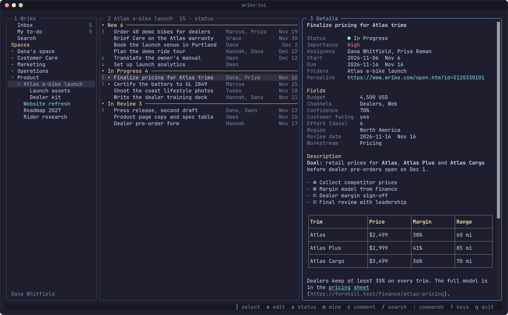
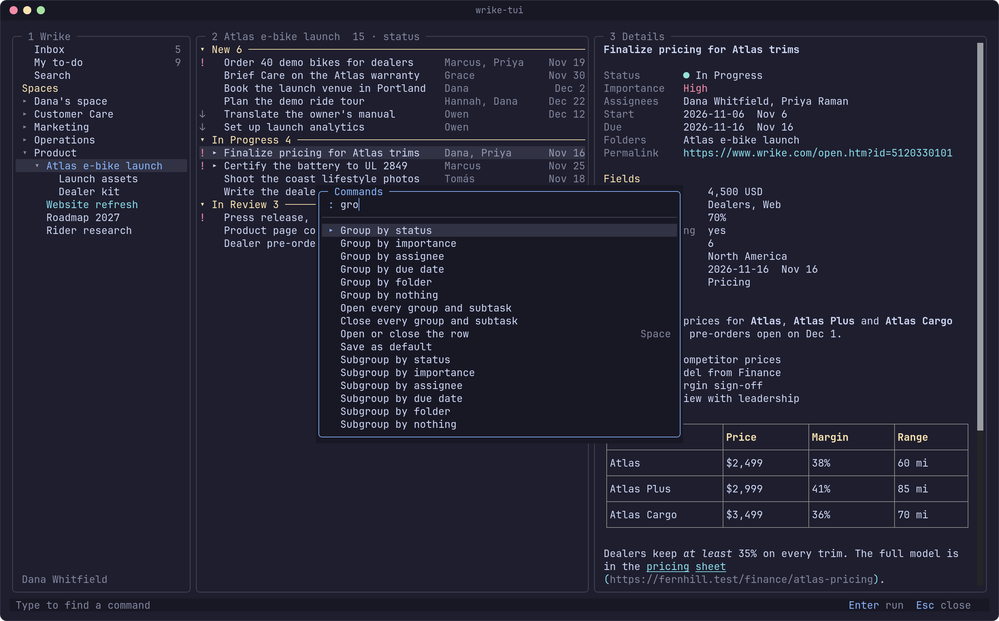
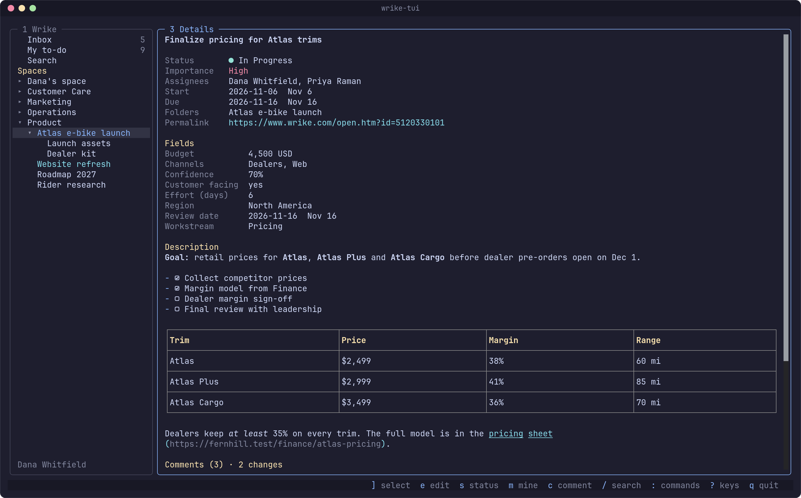
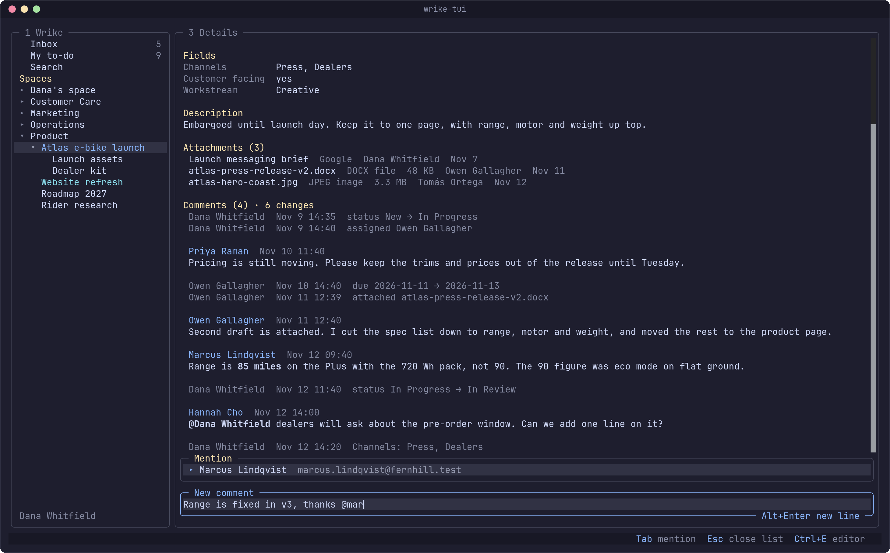
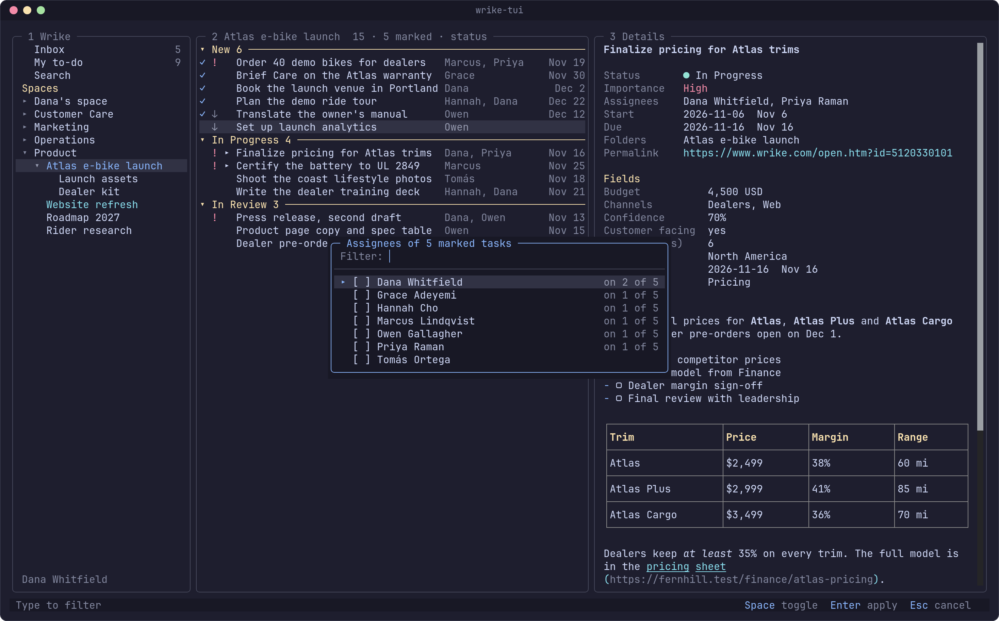

# wrike-tui

A keyboard-first terminal client for [Wrike](https://www.wrike.com). It shows
your Inbox and your to-do list, finds tasks, and lets you read, edit and answer
them without leaving the terminal.



## What it does

The navigation pane is your Inbox, My to-do, your favorites and every space you
can see, with its folders and projects. The list pane shows the tasks of
whatever you pick, and you shape it the way you want to read it: group,
subgroup, sort, filter and choose the columns. Subtasks nest under their
parent. The details pane is the open task, its custom fields, its attachments,
and its comments with the field history folded in by time.

You change a task where you read it. Title, status, importance, assignees,
dates and custom fields edit in place, and the description opens in your editor
as markdown. You write comments with `@` mentions, create tasks and subtasks,
file a task in more folders, cancel it or delete it. Mark a few tasks in a list
and one key changes all of them. Request forms are filled in a field at a
time.

It comes back where you left it. The next start restores the list, the open
folders and the open task, and the tree draws from a cache before Wrike
answers.

## What it does not do today

The Inbox is read-only, because Wrike's API cannot mark a notification read.
Search matches task titles only. Dependencies, effort, milestones, blueprints,
custom item types, time logs and approvals are not reached yet, and there is
one Wrike account at a time. Comments have no threaded replies. A request form
that needs a file or a person is finished in the browser.
[ROADMAP.md](ROADMAP.md) says what is planned and when.

## Install

macOS and Linux:

```sh
curl -fsSL https://raw.githubusercontent.com/joegeary/wrike-tui/main/install.sh | sh
```

Windows:

```powershell
irm https://raw.githubusercontent.com/joegeary/wrike-tui/main/install.ps1 | iex
```

Both check the download against the checksums the release publishes.
[docs/install.md](docs/install.md) has the requirements, a download by hand,
building from source and updating.

## A first run

```sh
wrike-tui auth login
wrike-tui
```

`auth login` asks whether you want to paste a Wrike permanent access token or
sign in through the browser with OAuth.
[docs/install.md](docs/install.md#log-in) says where to get a token.

Three keys carry most of it. `?` lists the keys that work where you are. `:`
opens the command palette, which lists only the commands that apply there. `e`
puts the open task in edit mode, where `j` and `k` walk its fields and `Enter`
edits the one you are on.

After that: `h` and `l` move between the panes, `i` and `t` show the Inbox and
My to-do, `/` searches, and `c` writes a comment.

## A look around

`:` opens the command palette over the pane you are in. Type part of a command
to find it. Grouping, sorting, filters and columns live here, along with the
commands that have no key.



`v` zooms the details pane. The task reads as one page: its status, importance,
assignees, dates and folders, its custom fields under Fields, and the
description rendered as markdown.



Comments and field history share one stream, ordered by time. `]` and `[`
select a comment, and your own can be edited for five minutes after you post
it. Type `@` and a few letters to mention someone.



`M` marks tasks in a list. While tasks are marked, the status, importance and
assignee keys change all of them, and one line in the status bar says how many
changed.



## Documentation

- [Install](docs/install.md): requirements, the installers, building from
  source, updating, logging in, the environment variables
- [Guide](docs/guide.md): the panes, shaping a list, editing a task, comments,
  bulk edit, request forms, what is kept between runs, the Wrike API limits
- [Keys](docs/keys.md): every key by where you are, and how to change them
- [Configuration](docs/configuration.md): `config.json`, themes, the files
  wrike-tui writes
- [Roadmap](ROADMAP.md): what is not done yet

## Develop

You need [Bun](https://bun.sh) 1.4 or later.

```sh
bun install
bun run dev         # run from source
bun run typecheck
bun run test        # unit and screen tests
bun run e2e         # build, then drive the binary in a detached tmux session
```

The tests never call Wrike. They run against a fake Wrike server with synthetic
data in `test/fake/`, and you can run the client against it too:

```sh
bun test/fake/serve.ts 4010
WRIKE_TOKEN=fake-token \
WRIKE_BASE_URL=http://127.0.0.1:4010/api/v4 \
WRIKE_MCP_URL=http://127.0.0.1:4010/mcp \
bun run dev
```

[docs/install.md](docs/install.md#build-from-source) has the rest: what the
tests need, the development variables, CI and how a release is built.

## License

MIT. See [LICENSE](LICENSE).
