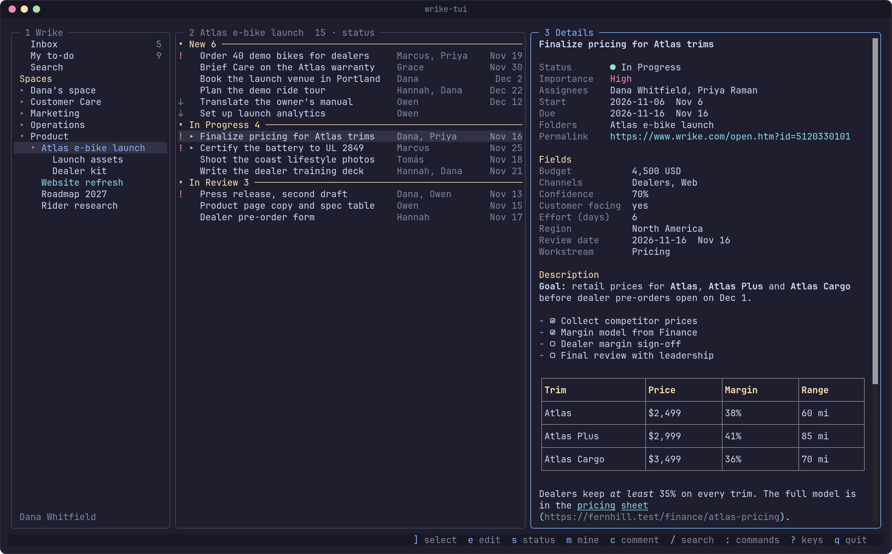
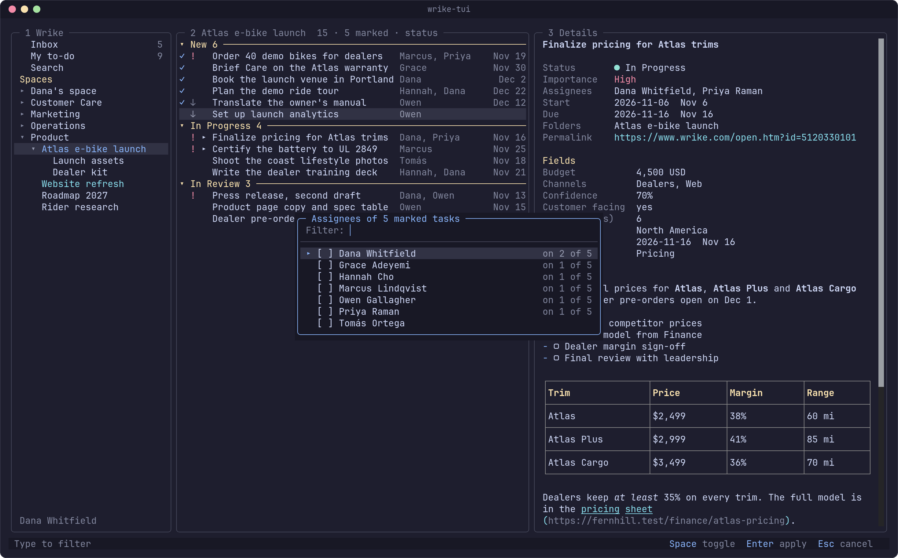
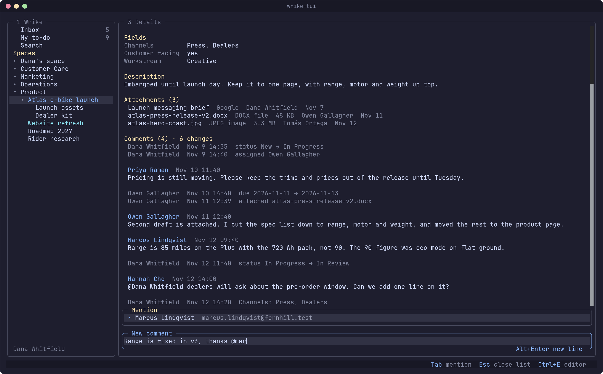

# Guide

wrike-tui is a terminal client for Wrike. Everything it shows comes from
Wrike's API, and everything it changes is written straight back, so the web app
and the terminal stay in step.

## The three panes

Left to right: where you are, the tasks there, and the task you have open.

`1`, `2` and `3` focus the navigation, list and details panes. `h` and `l`, or
the left and right arrows, move to the pane on the left or right. `v` zooms the
details pane. `?` shows the keys for the pane you are in, and
[keys.md](keys.md) lists all of them.

`r` refreshes the list, the open task, the people, the workflows and the open
spaces.

## Navigation

The navigation pane starts with the Inbox and My to-do, then your favorites,
then every space you can see. A space loads its tree when you open it. `Space`
opens or closes a space, a folder or a project. `Enter` on a row shows its
tasks in the list, and on a space, a folder or a project the focus stays in the
tree.

`i` shows the Inbox and `t` shows My to-do from anywhere.

### Inbox

The Inbox lists your unread notifications, newest first: mentions,
assignments, status changes and comments, with the task, the author and the
first line of a comment. `a` shows or hides the read ones. `Enter` opens the
task. A notification on a folder or a project opens in the browser.

The Inbox is read-only. See [Limits](#limits).

### My to-do

My to-do lists the active tasks assigned to you, grouped into Overdue, Today,
This week, Later and No date. This week runs through Sunday.

### Search

`/` searches by title across the account. Paste a permalink or a task ID
instead, and that task opens.

### Favorites

`F` keeps a space, a folder, a project or a task at the top of the navigation
pane, and `F` again removes it. In the tree, `J` and `K` move a favorite down
or up. Favorites are stored on your machine, because Wrike has no starred items
in its API.

## Shape a list

Each list keeps its own shaping: grouping, sorting, filters and columns. Press
`:` in a list and type part of a command.

| Command | What it does |
| --- | --- |
| Group by status, importance, assignee, due date, folder or nothing | Puts the tasks under headings. `Space` closes and opens a heading. |
| Subgroup by ... | Splits each group again. |
| Sort by due date, importance, status, title, last update or creation date | Makes that the first sort key and keeps the earlier keys as tie breakers. Choosing the same key again reverses it. |
| Reverse the sort | Reverses the first sort key. |
| Filter by assignee, status, importance or due date | Opens a picker for the values. Applying nothing removes the filter. |
| Only my tasks | Filters to the tasks assigned to you. |
| Clear the filters | Removes every filter. |
| Choose the columns | Importance, status, assignees, due date, start date, updated, folder and ID. A narrow pane drops columns to keep the title readable. |
| Open every group and subtask, Close every group and subtask | Expands or collapses the whole list. |
| Save as default | Writes the theme in use, whether field history is shown, and this list's shaping as the default for lists of its kind, to the config file. |

Three keys shape a list without the palette. `f` filters by title, and an empty
filter clears it. `x` shows or hides completed, cancelled and deferred tasks.
`Space` on a task opens or closes its subtasks, which nest under their parent.

A list loads 200 tasks at a time, and the next page loads as you near the end.
Shaping works on the tasks that are loaded, so a filter on a list that shows
`200+` only sees the first 200 until you load more.

[configuration.md](configuration.md#lists) says how to set the shaping a list
starts with.

## Edit a task

The keys for a task work in the list and in the details pane. `s` changes the
status, `p` the importance, `A` the assignees, and `m` assigns the task to you.
`o` opens it in the browser.

`e` puts the task in edit mode. `j` and `k` walk its fields, `Enter` edits the
one you are on, and `Esc` leaves. Title and dates are typed in place. Dates are
typed as `YYYY-MM-DD`, and an empty date clears it. Status, importance and
assignees open a picker.

`E` opens the description in your editor. See
[The description as markdown](#the-description-as-markdown).

### Custom fields

The details pane lists a task's custom fields under Fields, each value drawn by
its type. `e` walks on into them, and `Enter` opens the editor the type takes.
"Set a field" in the `:` palette gives the task a field it does not have yet,
with the fields the list's tasks use first.

- A drop-down picks one choice, and offers "Other value..." when the field
  allows one.
- A multi-select toggles choices with `Space`.
- A checkbox flips on `Enter`.
- Text, numbers, dates and durations are typed in place: a number with no more
  decimal places than the field allows, a date as `YYYY-MM-DD`, a duration in
  hours and minutes like `2h 30m`.

Every field clears: "Clear the field", nothing chosen, an empty input, or a
checkbox flipped off. Read-only and calculated fields say why they cannot be
edited.

Wrike has no call that says which fields apply to a task, and it accepts a
write to a field that does not apply without keeping it. When that happens,
the status bar says so.

## Bulk edit

`M` marks the task, or unmarks it, and moves to the next task. The list title
counts the marks. While tasks are marked, `s`, `p`, `A`, `m`, "Set a field",
"Cancel the task" and `D` in the list act on all of them, and one line in the
status bar says how many changed and why any failed. The details pane still
changes only the open task. `Esc` or "Clear marks" clears the marks, and so
does showing another list.

The assignee picker checks the people on all the marked tasks and says "on 2 of
5" beside someone on only some. Checking a person adds them to every marked
task, and unchecking one who was on all of them removes them.

Deleting and cancelling marked tasks ask once for all of them. Cancelled tasks
that need different Cancelled statuses of one workflow get a picker, and tasks
of several such workflows are refused with a note to cancel one workflow at a
time.

## Comments

`c` writes a comment. `Enter` posts it, and `Alt+Enter` or `Ctrl+J` starts a
new line. `Ctrl+E` finishes a long comment in your editor.

`]` and `[` select the next or previous comment, and `Esc` clears the
selection. `Enter` on your own comment edits it in the five minutes after you
post it, as in Wrike's web app. `d` deletes your own comment at any time, and
only `y` confirms.

### Mentions

Type `@` and a few letters to mention someone. A list of people opens under the
comment. The arrows or `Ctrl+N` and `Ctrl+P` move in it, `Tab` or `Enter`
writes the person's name as a mention, and `Esc` closes the list so you can
keep writing.

### Field history

Changes to the title, status, assignees, folders, dates, duration and custom
fields show among the comments by time, one line each. `H` hides them or shows
them again. A task opens with its newest 50 changes, and "Load older changes"
in the `:` palette brings the next 50.

## Attachments

A task's files are listed above the comments with their kind, size, author and
date. `]` and `[` select them along with the comments. `Enter` on a selected
file opens it in the browser. A selected image shows a thumbnail.

## Request forms

"Submit a request form" in the `:` palette searches Wrike's request forms as
you type. Pick one, and it walks you through the form a field at a time,
through the pages your answers lead to, and sends it. The task it creates
opens.

`Enter` keeps an answer and goes to the next field, and on the review it sends
the form. `Ctrl+B` goes back one field. `Space` picks or drops a check box.

A field that takes a file or a person can only be filled in the browser, and
`o` opens the form there.

## New tasks, folders, cancel and delete

`n` creates a task in the folder the list shows, or in a folder you pick from
My to-do, Search or the Inbox. `N` creates a subtask of the open task. The new
task opens at once, ready for `e`.

`L` files a task in another folder or project. A task can live in several.
"Take out of a folder" in the `:` palette removes one, never the last.

"Cancel the task" in the `:` palette moves it to its workflow's Cancelled
status. `D` sends it to the Recycle Bin after you confirm with `y`.

"Cancel the task", "Take out of a folder" and "Submit a request form" have no
key. Run them from the `:` palette.

## The description as markdown

A description opens in your editor as markdown when saving it unchanged would
write back the same HTML. Otherwise it opens as raw HTML, so that saving never
strips formatting you did not touch. Close the editor without a change to
cancel.

Markdown covers Wrike's formatting with a few additions:

| In Wrike | In the editor |
| --- | --- |
| Checklist | `- [ ] open` and `- [x] done` |
| Table | A pipe table whose first row is the header; ` ` breaks a line in a cell |
| Text color | `{color:#D81B60}text{color}` |
| Highlight | `=={#ffcc80}text==`; a bare `==text==` takes `#F8BBD0` |
| Underline | `++text++` |
| Image | `` |
| A link's `rel` | `[text](url){rel=nofollow}` |
| Bold, italic | `**b**` and `*i*`; `__strong__` and `_em_` keep Wrike's other tags |

Each blank line is a blank line in Wrike. A backslash at the end of a line is a
line break inside a paragraph, and one before a list or heading keeps the break
Wrike stored there. One blank line ends a list or a heading. A space markdown
would drop, at the end of a line or inside bold, reads `&#32;`.

The editor is `$VISUAL`, then `$EDITOR`, then `vi`.

## Copy

`y` copies a task's URL and `Y` copies its ID. Copy uses the OSC 52 terminal
sequence, so it works over SSH when your terminal allows it. Inside tmux,
`set-clipboard` must be `external` (the default) or `on`.

## What is kept between runs

wrike-tui comes back where you left it. The scope, the open folders, the
cursor, the shaping of each list and the open task are restored at the next
start, and the tree is drawn from a cache before Wrike answers.
`WRIKE_TUI_NO_RESTORE=1` starts on the Inbox instead.

Favorites are kept on your machine too. [configuration.md](configuration.md#files)
lists the files.

## Limits

These come from the Wrike API.

- The Inbox is read-only. Wrike has no public call to mark a notification read.
- My to-do lists the active tasks assigned to you. Tasks you pinned by hand in
  Wrike are not available through the API.
- Search matches task titles only.
- Favorites live on your machine. Wrike's API has no starred items.
- Request forms cannot attach files or pick people from the terminal. A
  required file or person field means finishing the form in the browser.
- Importance is changed one task at a time, because Wrike refuses it in a
  bulk update.
